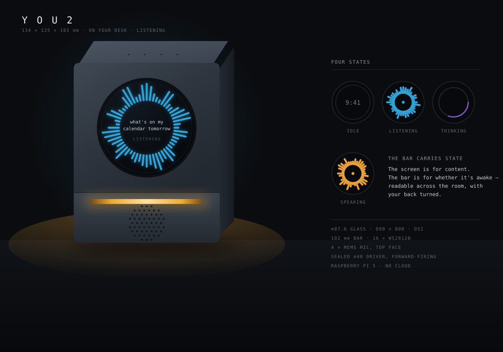
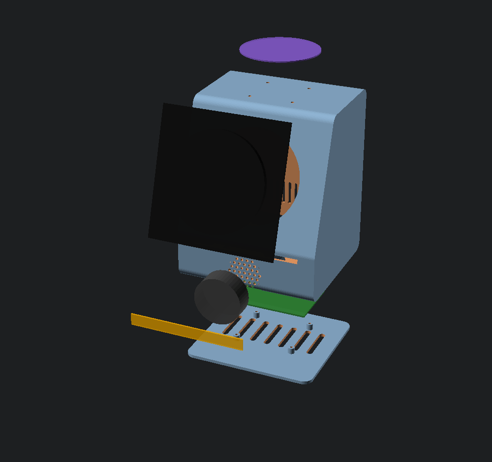

# YOU2

A desk-based voice assistant that runs entirely on its own hardware and gets to know you. You wake it by saying **"Friday"**.

Not a smart speaker. Not a wrapper around someone else's API. A small machine that sits on your desk, listens when you talk to it, answers out loud, and — the actual point — **remembers**. Every conversation makes it a little more yours, and none of it leaves the box.



`134 × 125 × 165 mm` · one round eye · four mics up top · one speaker forward · no cloud

---

## Why this and not a phone

Every AI gadget that died in the last three years died the same way: it did something your phone already does, slower, with a worse screen and a subscription. Humane sold its assets to HP for a fraction of what it raised. Rabbit's action model was mostly automation scripts. Limitless went to Meta, Bee to Amazon, both inside a year.

So You2 doesn't try to be a general assistant. It's built around the one thing a phone structurally cannot offer:

**Apple and Google will never ship local-only.** Their business models don't allow it. A device that promises your conversations never leave the room is making a claim the incumbents can't match — and once it has a year of context about your work, your people, and your preferences, it isn't replaceable by a better model.

The model is a download. The memory is the product.

---

## How it works

Two paths, running at completely different speeds.

**The hot path** has to finish in under a second or the whole thing feels broken — that, more than intelligence, is what made the AI Pin unusable. Wake word and voice-activity detection run continuously at almost no CPU cost. When you start speaking, transcription starts *while you're still talking*. The model starts generating on a partial transcript. Speech synthesis starts on the first complete sentence while the rest is still being written. Nothing waits for the stage before it to finish.

**The cold path** is where the product actually lives. Every turn is captured. A salience pass decides what's worth keeping, because most of it isn't. Then overnight, while the device is idle and plugged in, it re-reads the day, writes summaries, extracts durable facts, and links them into what it already knows.

That last step is the one nobody does, and it's why every "AI with memory" degrades after a month — they accumulate instead of consolidating, so retrieval gets noisier the longer you use it. Facts need identity and versioning so a new preference *replaces* the old one instead of sitting next to it.

See [diagrams/architecture.svg](diagrams/architecture.svg) for the whole picture, and **[docs/design.md](docs/design.md) for the complete design document** — self-contained, everything in one place.

---

## The brain

The cold path is built. It is in [software/](software/), it runs on a laptop with no hardware and no network, and the
design is in **[docs/brain.md](docs/brain.md)**.


It is a brain rather than a vector store with a cron job, and that is a specification rather than a metaphor:

**Retrieval is bounded spreading activation.** Embeddings pick a handful of starting points; everything after that is
graph traversal with a decay term and a firing threshold. Retrieval cost is set by the shape of the cascade, not by
the size of the store — a test asserts that a 30× larger store visits the same number of neurons for the same cue.
The system *structurally cannot* read everything.

**The token budget is a global workspace.** Selection is a competition with lateral inhibition, not a truncation.
Winning has consequences: winners are strengthened and wired to each other, which is where the association graph
actually comes from. Nobody writes those edges by hand.

**Salience is prediction error.** The workspace is what memory predicted would be relevant, so surprise is the
distance from the retrieval that already ran. One dot product, and no asking a model to rate importance — models
rate everything as important out of context.

**Nightly multiplicative downscaling** is what makes retrieval sharpen with age instead of degrading. It is about
forty lines and it is the highest-leverage thing in the project.

**The weights are the cortex; the graph is the person.** World knowledge lives in the model and is never stored, so
the store stays small while the answers stay sharp. Inference is lazy — except a derivation drawn three times, which
compiles into a stored fact carrying its premises. It is the only thing here that grows with *use* rather than with
elapsed time, and truth maintenance retires it when a premise dies.

### What it measures

A year of synthetic history with planted ground truth, run through the real pipeline at an accelerated clock — the
design doc's "learn in an afternoon what would otherwise take a year", made concrete. 1,178 utterances, 353 nights,
about 46 seconds.

| day | probe precision | stale leakage | neurons | edges |
|---|---|---|---|---|
| 30 | 0.50 | 0.00 | 118 | 762 |
| 365 | **1.00** | **0.00** | 1,075 | 2,150 |

Precision **rises** with elapsed time and superseded values never reach the block. If that curve fell, consolidation
would not be working — and that is exactly where every memory system that has shipped fails.

The ablations matter as much. Removing the fan effect takes neurons-visited from 14 to **407**; removing inhibition
halves block diversity; plain top-k scores the *highest* topical focus and the *lowest* diversity, which is naive
RAG's failure mode measured rather than asserted. One mechanism — the salience gate — changes nothing measurable,
and [docs/brain.md §15.2](docs/brain.md) says so rather than defending it.

### And who they are

Memory answers *what did they say*. A second brain has to answer *who are they*,
and that is derived from what is already in the store rather than from a
settings page: the shape of their week, how they feel about each thing and
**which way it is moving**, how they talk and therefore how to talk back, what
is weighing on them, and what has changed about them lately.

On a seeded month it says things only something that has watched you for weeks
can say — *souring on the Kestrel contract* over eleven mentions and five weeks,
*at their best in the morning*, *boiler service, overdue*, *they speak in short
sentences, match that*. Every claim carries its sample size, and thin evidence
produces silence rather than a hedge: telling someone something wrong about
themselves is the moment they stop believing any of it.

### And ears

The wake word is **"Hey Friday"**. Wake, VAD, endpointing, ASR and TTS are each
an interface with a real adapter and a working fallback, so the whole loop —
including barge-in, the thing most likely to sink the project — runs and is
tested with no hardware and no models.

```bash
cd software && python3 -m venv .venv && .venv/bin/pip install -e ".[dev]"
.venv/bin/you2 demo            # seed a month of life and open the eye
.venv/bin/you2 listen          # the whole device: ears, brain, voice
.venv/bin/you2 why "..."       # print the whole retrieval
.venv/bin/you2 eval --ablate   # check every mechanism earns its place
```

Flashing a card: **[deploy/](deploy/)**.

---

## Repo layout

```
You2/
├── cad/            parametric OpenSCAD enclosure — F5 to preview, F6 to render
├── diagrams/       system architecture + dimensioned GA drawing
├── docs/           design.md (read this first) · architecture · bill of materials
├── hardware/       wiring, pinouts, assembly
└── software/       the pipeline and the memory system
```

---

## The hardware

A wedge. Angled face so the screen looks at you rather than the ceiling, microphones on the top surface as far from the speaker as the enclosure allows, and one forward-firing driver so speech arrives at your face instead of bouncing off the desk.

The front is one big round display — the "eye" — with a light bar across the skirt beneath it. The bar is not decoration. A voice device has to tell you what state it's in, and light is the only channel that does it without interrupting you: idle, listening, thinking, speaking.

| | |
|---|---|
| **Shell** | 134 × 125 × 165 mm, 2.4 mm walls, 18° raked face over a 46 mm skirt, PETG |
| **Eye** | Waveshare 3.4″ round DSI, 800 × 800, ⌀87.6 glass on a 115 × 115 carrier |
| **Light** | 2× NeoPixel Stick 8 → a 102 mm bar across the skirt |
| **Ears** | Seeed reSpeaker over USB — hardware AEC in XMOS silicon. Lite (2-mic, $25) or Flex XVF3800 (4-mic on FPC, $55) |
| **Voice** | ⌀40 enclosed driver in a sealed chamber in the skirt |
| **Brain** | Raspberry Pi 5 **2 GB** on M3 standoffs — LLM runs on an API |
| **Power** | Official 27 W USB-C PD, always on, no battery. Passive cooling — no fan near the mics |

DSI rather than DPI is not an aesthetic choice. The Pi 5 has two spare 4-lane MIPI transceivers, so **DSI costs zero GPIO** and leaves the whole 40-pin header free. The only off-the-shelf round DPI panel consumes GPIO 0–27 with nothing spare — not even a pin for the LED data line.

Two things that will each cost you an afternoon: the display box ships **15-pin cables and a Pi 5 needs 22-pin** (wrong cable = black screen, no error), and the panel must be **fed 5 V separately** because the DSI ribbon can't supply enough current.

A ring around the eye was the original idea and it doesn't survive contact with parts: the largest stocked NeoPixel ring is 65.5 mm outer, so against an 87.6 mm display it would sit *behind* the glass. Hence a bar.

Dimensioned drawing: [diagrams/enclosure.svg](diagrams/enclosure.svg) · Model: [cad/you2.scad](cad/you2.scad) · Renders: [cad/renders/](cad/renders/)



### The screen

A round 800 × 800 panel is not a phone screen and shouldn't pretend to be one. Four states, each readable at a glance from across a room:

**Idle** — the time, dimmed. **Listening** — a radial waveform on live mic level, with the transcript forming in the middle. **Thinking** — a single slow arc. **Speaking** — the same waveform in amber, driven by output rather than input.

The light bar duplicates state deliberately. The screen carries content; the bar carries *is it awake*, and that has to survive being read from the far side of the room with your back turned.

---

## Where this is

Design phase. **Full build is $248** — see [docs/bom.md](docs/bom.md).

The LLM runs on an API (Groq's free tier covers ~480× this workload), which deleted the local-inference requirement and
with it the expensive half of the hardware. A Pi 5 **2 GB** at $65 is the same quad Cortex-A76 silicon as the $175 8 GB
board; the RAM was only ever there to hold a model that now lives elsewhere.

The CAD is parametric, rev C. It **renders clean and exports as a manifold solid** — shell and base plate both come back `Status: NoError`, so the geometry is printable. STLs are in [cad/stl/](cad/stl/), renders in [cad/renders/](cad/renders/).

What that does *not* mean is that it fits. Every part dimension came from a datasheet rather than calipers, and vendor listings for these parts are routinely wrong. Don't print until the display, LED sticks and mic array are physically in front of you.

Nothing is soldered yet.

---

## Design rules

Things that are easy to lose sight of once you're deep in it:

1. **Under a second, or it doesn't matter how smart it is.** Latency is the product. Overlap every stage.
2. **The model is a commodity; the memory is not.** Don't spend six months on inference optimisation and two weeks on memory. The LLM is one `base_url` string — local llama.cpp, a LAN box and a cloud API are all the same code path.
3. **Consolidate, don't accumulate.** A memory system that only appends gets worse with use.
4. **No feed, no notifications, no engagement loop.** It speaks when spoken to. That restraint is a feature.
5. **Don't let it take actions yet.** Rabbit died on exactly this. Conversation and memory first; actions are a much later problem.
6. **Wake-word activated, not always-recording.** Other people are in the room and haven't agreed to anything.
7. **The audio stays on USB.** The reSpeaker has an I2S mode. Taking it would re-impose the GPIO conflict that USB freed you from, to chase milliseconds that aren't the bottleneck — ASR is.
