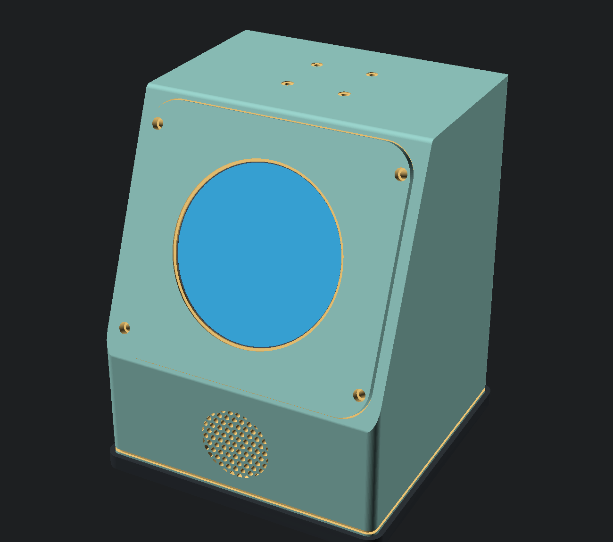
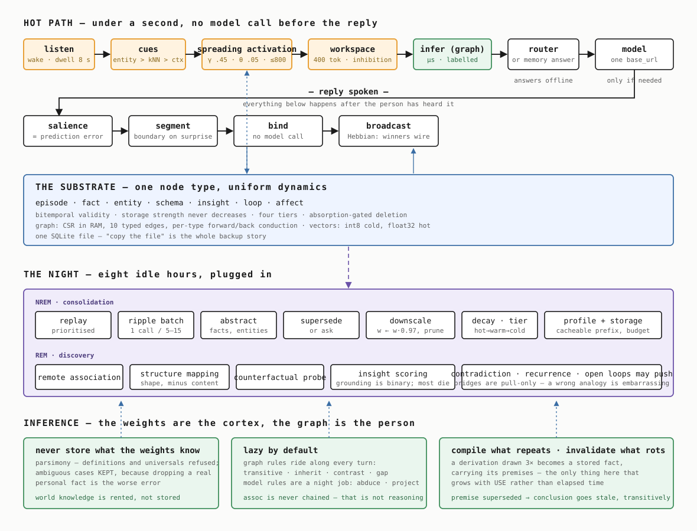
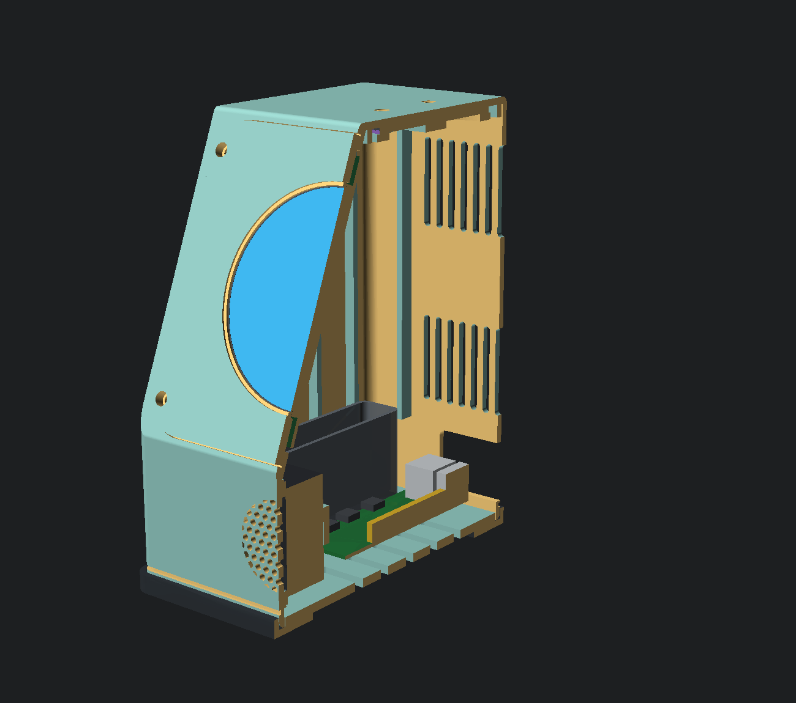
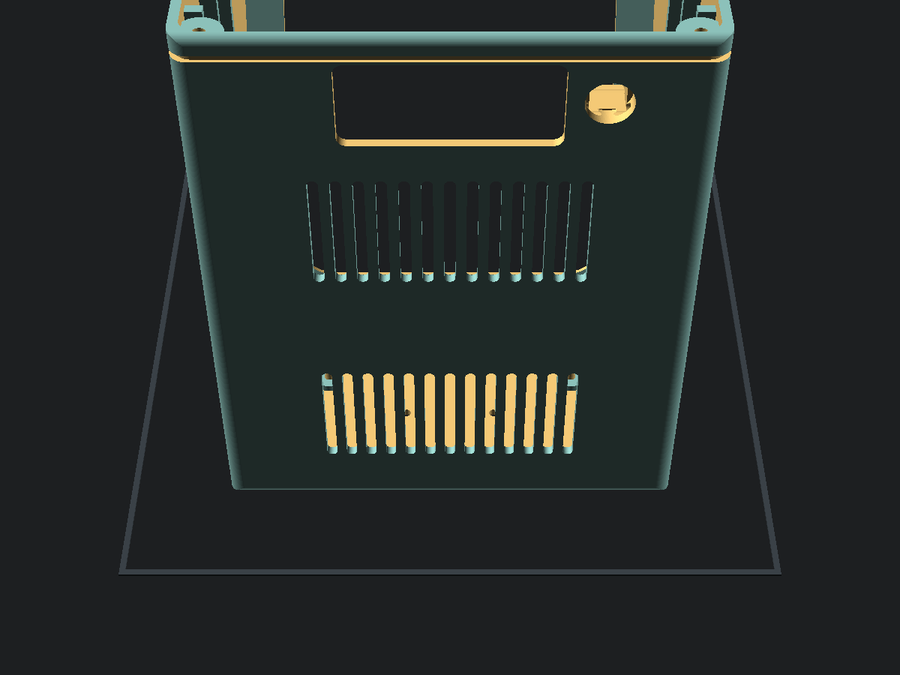
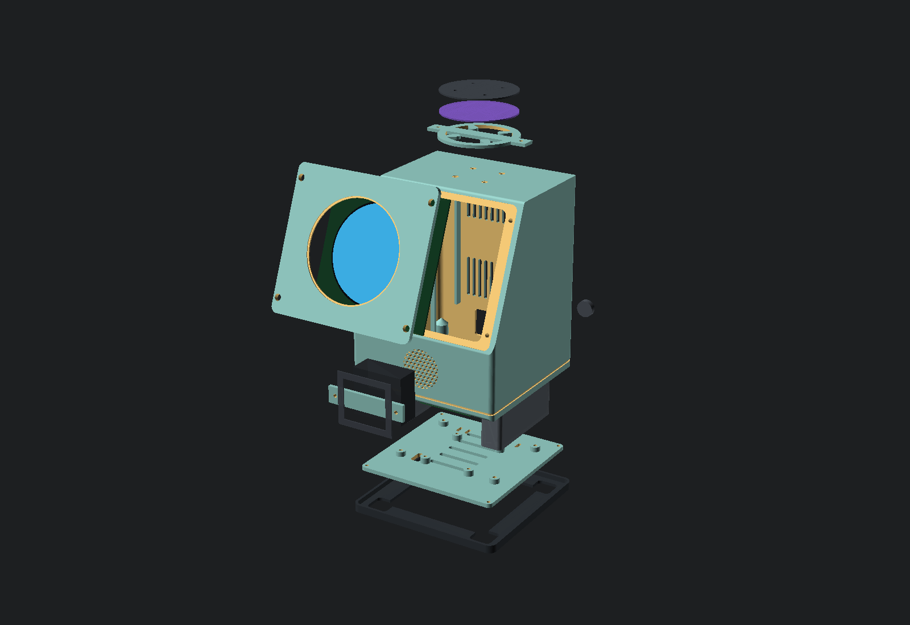

# YOU2

A desk-based voice assistant that runs entirely on its own hardware and gets to know you. You wake it by saying **"Hey Friday"**.

Not a smart speaker. Not a wrapper around someone else's API. A small machine that sits on your desk, listens when you talk to it, answers out loud, and — the actual point — **remembers**. Every conversation makes it a little more yours, and none of it leaves the box.



`152 × 150 × 192 mm` · one round eye · four mics up top · one speaker forward · no cloud

---

## Why this and not a phone

Every AI gadget that died in the last three years died the same way: it did something your phone already does, slower, with a worse screen and a subscription. Humane sold its assets to HP for a fraction of what it raised. Rabbit's action model was mostly automation scripts. Limitless went to Meta, Bee to Amazon, both inside a year.

So You2 doesn't try to be a general assistant. It's built around the one thing a phone structurally cannot offer:

**Apple and Google will never ship local-only.** Their business models don't allow it. A device that promises your conversations never leave the room is making a claim the incumbents can't match — and once it has a year of context about your work, your people, and your preferences, it isn't replaceable by a better model.

The model is a download. The memory is the product.

---

## How it works

Two paths, running at completely different speeds.

**The hot path** has to finish in under a second or the whole thing feels broken — that, more than intelligence, is what made the AI Pin unusable. Wake word and voice-activity detection run continuously at almost no CPU cost. When you start speaking, transcription starts *while you're still talking*. The model starts generating on a partial transcript. Speech synthesis starts on the first complete sentence while the rest is still being written. Nothing waits for the stage before it to finish.

**The cold path** is where the product actually lives. Every turn is captured. A salience pass decides what's worth keeping, because most of it isn't. Then overnight, while the device is idle and plugged in, it re-reads the day, writes summaries, extracts durable facts, and links them into what it already knows.

That last step is the one nobody does, and it's why every "AI with memory" degrades after a month — they accumulate instead of consolidating, so retrieval gets noisier the longer you use it. Facts need identity and versioning so a new preference *replaces* the old one instead of sitting next to it.

See [diagrams/architecture.svg](diagrams/architecture.svg) for the whole picture, and **[docs/design.md](docs/design.md) for the complete design document** — self-contained, everything in one place.

Picking this up cold? **[HANDOFF.md](HANDOFF.md)** for the software and **[handoff_hardware.md](handoff_hardware.md)** for the object — what exists, what doesn't, and what will bite you.

---

## The brain

The cold path is built. It is in [software/](software/), it runs on a laptop with no hardware and no network, and the
design is in **[docs/brain.md](docs/brain.md)**.



It is a brain rather than a vector store with a cron job, and that is a specification rather than a metaphor:

**Retrieval is bounded spreading activation.** Embeddings pick a handful of starting points; everything after that is
graph traversal with a decay term and a firing threshold. Retrieval cost is set by the shape of the cascade, not by
the size of the store — a test asserts that a 30× larger store visits the same number of neurons for the same cue.
The system *structurally cannot* read everything.

**The token budget is a global workspace.** Selection is a competition with lateral inhibition, not a truncation.
Winning has consequences: winners are strengthened and wired to each other, which is where the association graph
actually comes from. Nobody writes those edges by hand.

**Salience is prediction error.** The workspace is what memory predicted would be relevant, so surprise is the
distance from the retrieval that already ran. One dot product, and no asking a model to rate importance — models
rate everything as important out of context.

**Nightly multiplicative downscaling** is what makes retrieval sharpen with age instead of degrading. It is about
forty lines and it is the highest-leverage thing in the project.

**The weights are the cortex; the graph is the person.** World knowledge lives in the model and is never stored, so
the store stays small while the answers stay sharp. Inference is lazy — except a derivation drawn three times, which
compiles into a stored fact carrying its premises. It is the only thing here that grows with *use* rather than with
elapsed time, and truth maintenance retires it when a premise dies.

### What it measures

A year of synthetic history with planted ground truth, run through the real pipeline at an accelerated clock — the
design doc's "learn in an afternoon what would otherwise take a year", made concrete. 1,178 utterances, 353 nights,
about 46 seconds.

| day | probe precision | stale leakage | neurons | edges |
|---|---|---|---|---|
| 30 | 0.50 | 0.00 | 118 | 762 |
| 365 | **1.00** | **0.00** | 1,075 | 2,150 |

Precision **rises** with elapsed time and superseded values never reach the block. If that curve fell, consolidation
would not be working — and that is exactly where every memory system that has shipped fails.

The ablations matter as much. Removing the fan effect takes neurons-visited from 14 to **407**; removing inhibition
halves block diversity; plain top-k scores the *highest* topical focus and the *lowest* diversity, which is naive
RAG's failure mode measured rather than asserted. One mechanism — the salience gate — changes nothing measurable,
and [docs/brain.md §15.2](docs/brain.md) says so rather than defending it.

### And whether what went in was right

That curve says consolidation holds. It cannot say the facts were correct, because it feeds the rule extractor a
corpus those same rules generated. So there is a second instrument: 24 sessions of speech as people actually produce
it, labelled by hand — and labelled as much with **22 traps** as with facts. Questions, hypotheticals, world
knowledge, other people's opinions, things that were true for an afternoon. Extractors are eager, and a memory that
fills with *the user is running late* is worse than an empty one, because unlike a missing fact nobody ever notices.

The number nobody measures is **key stability**: the same thing, said twice weeks apart in different words — one key,
or two? Two means the new preference sits *beside* the old one instead of replacing it, and no amount of
consolidation downstream can fix that. So nothing an extractor produces is trusted, the rules included, and a
deliberately sloppy model — values welded into keys, invented facts, first-person claims — measures what the
checking is worth rather than leaving it asserted:

| | precision | key stability | traps fired |
|---|---|---|---|
| a sloppy model, raw | 0.66 | **0.00** | 4 |
| the same model, checked | **1.00** | **0.67** | **0** |

It has already earned it. Building the instrument turned up a fact stored as *"the car insurance on the third of
March"* — a subject, a date, and no claim — and a retrieval block that printed the same sentence **twice**.

### And who they are

Memory answers *what did they say*. A second brain has to answer *who are they*,
and that is derived from what is already in the store rather than from a
settings page: the shape of their week, how they feel about each thing and
**which way it is moving**, how they talk and therefore how to talk back, what
is weighing on them, and what has changed about them lately.

On a seeded month it says things only something that has watched you for weeks
can say — *souring on the Kestrel contract* over eleven mentions and five weeks,
*at their best in the morning*, *boiler service, overdue*, *they speak in short
sentences, match that*. Every claim carries its sample size, and thin evidence
produces silence rather than a hedge: telling someone something wrong about
themselves is the moment they stop believing any of it.

### And ears

The wake word is **"Hey Friday"**. Wake, VAD, endpointing, ASR and TTS are each
an interface with a real adapter and a working fallback, so the whole loop —
including barge-in, the thing most likely to sink the project — runs and is
tested with no hardware and no models.

```bash
cd software && python3 -m venv .venv && .venv/bin/pip install -e ".[dev]"
.venv/bin/you2 demo            # seed a month of life and open the eye
.venv/bin/you2 listen          # the whole device: ears, brain, voice
.venv/bin/you2 why "..."       # print the whole retrieval
.venv/bin/you2 eval --ablate   # check every mechanism earns its place
```

Flashing a card: **[deploy/](deploy/)**.

---

## Repo layout

```
You2/
├── cad/                  you2-revD.scad — the enclosure, parametric and self-sizing
│   ├── check.py          gate: every part is one connected solid
│   ├── fit.py            gate: no two parts occupy the same space
│   └── renders/revD/     hero, exploded, section, and the six print plates
├── docs/build.html       THE BUILD DOCUMENT — every part, plate, fastener, step
├── hardware/             wiring · assembly · what to measure before you buy
├── diagrams/             system architecture + the brain
├── docs/                 design.md · brain.md · hardware-plan.md · bom.md
├── deploy/               flash a card that boots straight into the eye
├── software/             the brain, the ears, and the eye
├── HANDOFF.md            the project · handoff_software.md · handoff_hardware.md
└── ...
```

---

## The hardware

A wedge. Angled face so the screen looks at you rather than the ceiling, microphones on the top surface as far from the speaker as the enclosure allows, and one forward-firing driver so speech arrives at your face instead of bouncing off the desk.

The front is one big round display — the "eye" — sitting 2.2 mm behind a chamfered bezel, so the rim is always the first thing to touch anything.

Everything else on the object is structural, and only one number in the model is purely about how it looks: `fp_r`, the corner radius of the faceplate and the rebate it drops into. At 6 mm the face was a hard-cornered rectangle carrying a circle, inside the shell's own rectangle — three outlines arguing. At 16 the plate reads as one soft shape around the eye and the four exposed screws land on the curve rather than in square corners. It cannot go higher: at 17 the corner arc leaves under three perimeters of material outboard of a screw counterbore, and an assert says so with the shortfall in millimetres.

**Almost nothing about the size was chosen.** The display carrier sets the face length, the driver box sets the skirt, and the mic array sets the depth — the height is derived, not picked. Width and depth are the exception: they are hand-typed constants that the asserts *guard* rather than derive, and they are the two numbers to raise when one fires. Change a part dimension at the top of the model and the enclosure re-sizes itself; if a measurement makes it unbuildable, 17 asserts fail with the reason rather than rendering a shell you cannot assemble.

| | |
|---|---|
| **Shell** | 152 × 150 × 192 mm, 3.0 mm walls, 22° raked face over a 65 mm skirt, PETG |
| **Eye** | Waveshare 3.4″ round DSI, 800 × 800, ⌀87.6 glass on a 115 × 115 carrier |
| **Ears** | Seeed reSpeaker Flex XVF3800 Circular-4 over USB — hardware AEC in XMOS silicon |
| **Voice** | Enclosed 4 Ω driver on a gasketed seat in the skirt, clamped with 20 % squash |
| **Brain** | Raspberry Pi 5 **2 GB** on brass standoffs — LLM runs on an API |
| **Power** | Official 27 W USB-C PD, one plug, always on, no battery. Passive cooling — no fan near the mics |
| **Mass** | 730 g of filament across 11 printed parts, plus ~200 g of optional sand ballast |



### It is built for one ordinary printer

220 × 220 × 250 bed, 0.4 mm nozzle, one material at a time. **No machined parts, no laser cutting, and no thread cut into plastic anywhere** — all 24 are brass heat-set inserts, which need a soldering iron and nothing else. In the default build there is nothing to solder.

Six plates, every one fitting the bed, none needing support. The trick is the shell's orientation: printed **top face down**, the bottom opening faces up so the cavity has no ceiling, the raked face and skirt become steep self-supporting walls, and the four microphone ports print crisp against the plate. Measured rather than asserted, in the model's own plate-1 orientation — 141.6 cm² of bed contact and 31.2 cm² facing downward at more than 60°, spread across 143 separate patches. Only seven of them are larger than 1 cm², and the biggest is 7.2 cm² of shadow-gap ledge that any slicer bridges. No large flat unsupported span anywhere, which is the thing that actually fails.



### The display never enters the shell

It bolts to a separate faceplate, from outside, and the faceplate goes on last. That one move is why rev D can be assembled at all — and it means a wrong display dimension costs a 56 g reprint instead of a 400 g one. Print the faceplate first and offer the real panel up to it.



DSI rather than DPI is not an aesthetic choice. The Pi 5 has two spare 4-lane MIPI transceivers, so **DSI costs zero GPIO** and leaves the whole 40-pin header free. The only off-the-shelf round DPI panel consumes GPIO 0–27 with nothing spare.

Two things that will each cost you an afternoon: the display box ships **15-pin cables and a Pi 5 needs 22-pin** (wrong cable = black screen, no error), and the panel must be **fed 5 V separately** because the DSI ribbon can't supply enough current.

### Two gates, because a render lies

`Status: NoError` means the mesh is manifold. It does not mean the part is one object, and it does not mean anything fits — rev C rendered clean and was a sealed box in two disconnected pieces. And a render draws parts in different colours and lets them pass straight through one another.

```bash
python3 cad/check.py cad/you2-revD.scad   # every part is ONE connected solid
python3 cad/fit.py   cad/you2-revD.scad   # no two parts share space
```

Between them and 17 in-model asserts they caught **23 defects renders did not show** — a microphone array overhanging the top face by 2 mm, a driver that never touched its own seal, eight insert holes bored at the insert's own diameter, and two Ø10 × 24 mm horizontal cantilevers that would have needed support towers built from the bare bed inside a sealed cavity.

Model: [cad/you2-revD.scad](cad/you2-revD.scad) · Renders: [cad/renders/revD/](cad/renders/revD/) · **Build document: [docs/build.html](docs/build.html)**

### The light bar, and why it is off

The original design put a 102 mm light bar across the skirt to signal state — idle, listening, thinking, speaking. It is the only soldering in the project, the only level shifter, the only second supply, and a 459 mm² unsealed aperture in the front face just above the driver. It also costs 14 mm of height and 8 mm of depth.

An 800 × 800 emissive disc showing a full-field colour is more visible across a room than a 4.5 mm diffused slot. `LED_BAR = false` is the default; set it true and the model re-sizes itself if you disagree — 158 × 158 × 207 rather than 152 × 150 × 192.

Until recently that was a claim rather than a fact. Nothing ran the switches, so `LED_BAR = true` exported a shell with a 1.7 × 1.2 × 2.0 mm chip floating at each side — the rev C failure exactly, in a variant the documentation called clean. `cad/check.py --variants` runs every part under every switch combination now.

### The screen

A round 800 × 800 panel is not a phone screen and shouldn't pretend to be one. Four states, each readable at a glance from across a room:

**Idle** — the time, dimmed. **Listening** — a radial waveform on live mic level, with the transcript forming in the middle. **Thinking** — a single slow arc. **Speaking** — the same waveform in amber, driven by output rather than input.

State has to survive being read from the far side of the room with your back turned, which is what the light bar was for. With the bar off by default, the screen carries both — content in the middle, and a full-field colour at the edge that reads as *is it awake* from across a room. An 800 × 800 emissive disc is better at that job than a 4.5 mm slot ever was.

---

## Where this is

Design phase, and honestly so. The software runs; **nothing physical has been built** — nothing printed, no part ordered, no dimension measured with a caliper.

**Parts come to ≈ $351**, roughly $410 delivered — the list is in [docs/build.html](docs/build.html). Five older costings used to live in [docs/bom.md](docs/bom.md); all five bought a two-microphone board for a four-microphone enclosure and omitted every fastener, gasket and membrane, so they have been deleted. What is left in that file is the reasoning they were wrapped around: why the LLM moved off the device, and the five things most likely to go wrong.

The LLM runs on an API (Groq's free tier covers ~480× this workload), which deleted the local-inference requirement and
with it the expensive half of the hardware. A Pi 5 **2 GB** at $65 is the same quad Cortex-A76 silicon as the $175 8 GB
board; the RAM was only ever there to hold a model that now lives elsewhere.

The enclosure is gated rather than merely rendered — every part exports as a single connected solid, no two parts occupy the same space, and 17 asserts check the things neither gate can see. **That still is not a claim that it fits.** Every dimension came from a datasheet, and vendor listings for these parts are routinely wrong.

**One number can invalidate the design.** Seeed describes the mic array as *"44 mm spacing arranged in a circular layout"*. If that is the pitch-circle diameter, this works. If it means the distance between adjacent capsules — which is what "spacing" means on the linear-4 sibling — the pitch circle is 62.2 mm, and at that value the model refuses to render. Not because the ports fall off the board: the membrane's outer edge still sits 2.3 mm inside a Ø73 PCB. Because 2.3 mm of rim is not a bond line for an adhesive-backed Ø6 vent, and the model asserts a 4 mm land. Settle it with calipers before ordering: [hardware/measure-first.md](hardware/measure-first.md).

In the default build there is **nothing to solder**. A soldering iron is still needed, for 24 heat-set inserts.

---

## Design rules

Things that are easy to lose sight of once you're deep in it:

1. **Under a second, or it doesn't matter how smart it is.** Latency is the product. Overlap every stage.
2. **The model is a commodity; the memory is not.** Don't spend six months on inference optimisation and two weeks on memory. The LLM is one `base_url` string — local llama.cpp, a LAN box and a cloud API are all the same code path.
3. **Consolidate, don't accumulate.** A memory system that only appends gets worse with use.
4. **No feed, no notifications, no engagement loop.** It speaks when spoken to. That restraint is a feature.
5. **Don't let it take actions yet.** Rabbit died on exactly this. Conversation and memory first; actions are a much later problem.
6. **Wake-word activated, not always-recording.** Other people are in the room and haven't agreed to anything.
7. **A render is not a check.** `Status: NoError` says the mesh is manifold, nothing more. Run `cad/check.py` and `cad/fit.py` before every print, and add an assert whenever you add a feature that depends on a dimension.
8. **Measure before you print, not before you assemble.** Every part dimension here came from a datasheet. The faceplate is 56 g and confirms four of the seven numbers that matter.
9. **The audio stays on USB.** The reSpeaker has an I2S mode. Taking it would re-impose the GPIO conflict that USB freed you from, to chase milliseconds that aren't the bottleneck — ASR is.
